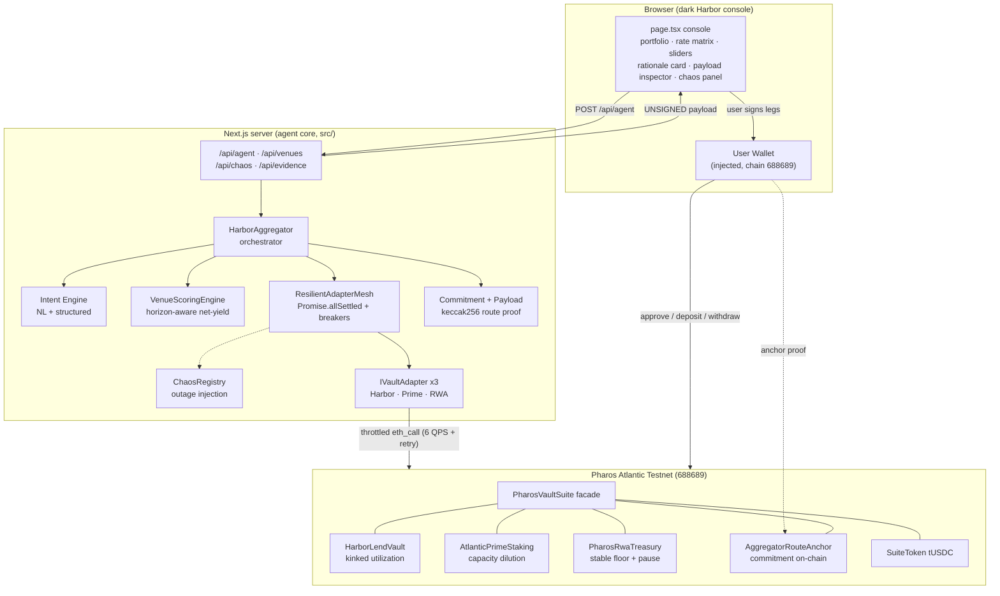
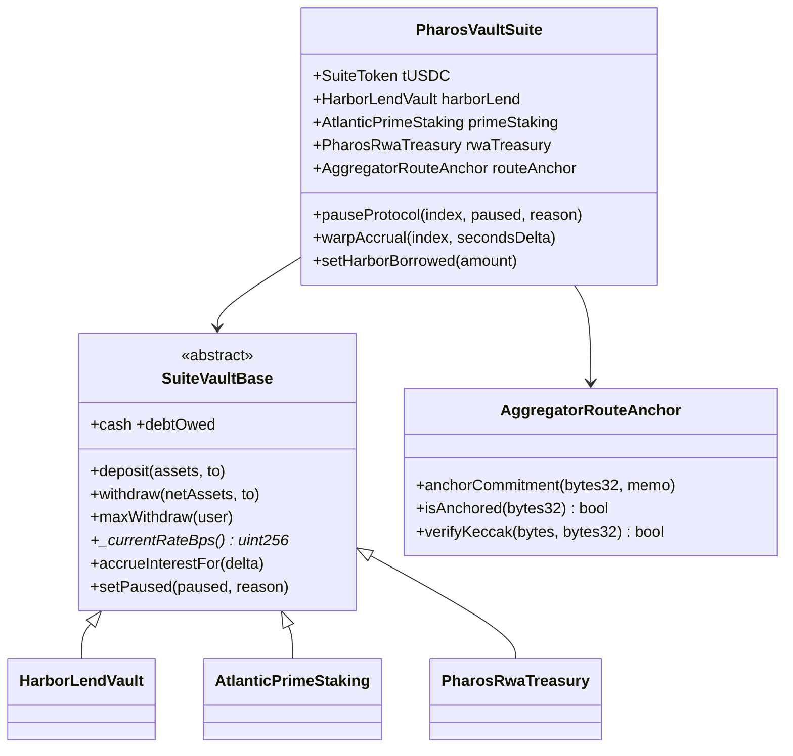
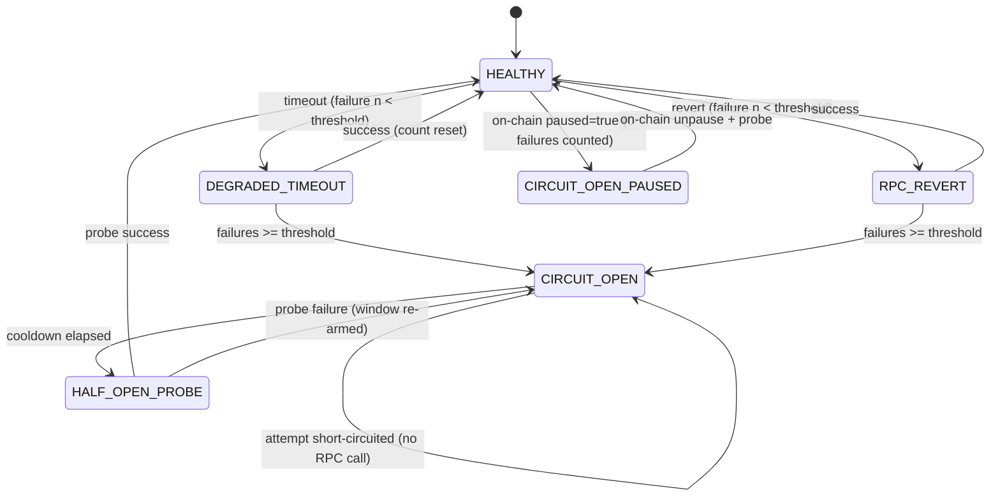
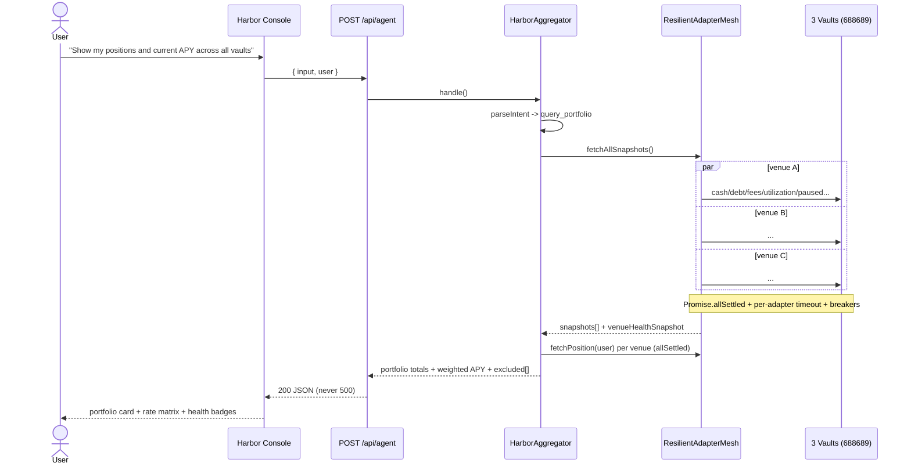
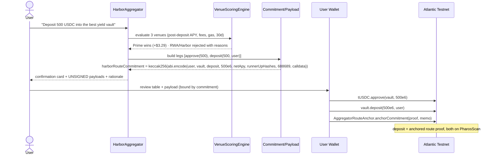
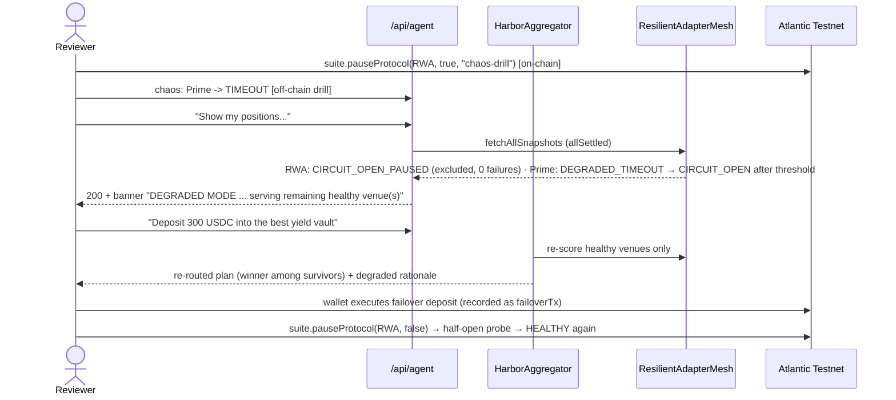

# ARCHITECTURE — Pharos Multi-Protocol Aggregator (Harbor-Style Cross-Vault Query & Non-Custodial Action Router)

> Network: **Pharos Atlantic Testnet** · chainId **688689** · RPC `https://atlantic.dplabs-internal.com`
> Stack: Next.js 15 (App Router) · TypeScript strict · Tailwind v4 · viem · wagmi v2 · vitest · solc 0.8.x

---

## Table of Contents

1. [System Topology](#1-system-topology)
2. [The Adapter Pattern: 3 Protocols, 1 Interface](#2-the-adapter-pattern-3-protocols-1-interface)
3. [On-Chain Suite Design (`PharosVaultSuite.sol`)](#3-on-chain-suite-design)
4. [Net-Yield Routing Math (Requirement 03)](#4-net-yield-routing-math)
5. [Withdrawal Opportunity-Cost Solver & Splitting (Innovation #3)](#5-withdrawal-solver)
6. [Fault-Isolation State Machine (Requirement 04 + Innovation #4)](#6-fault-isolation-state-machine)
7. [Non-Custodial Airgap & Cryptographic Route Commitment (Requirement 02 + Innovation #2)](#7-non-custodial-airgap--route-commitment)
8. [Intent Engine (NL + Structured)](#8-intent-engine)
9. [Sequence Diagrams](#9-sequence-diagrams)
   - 9.1 Unified Query
   - 9.2 Optimal Deposit
   - 9.3 Split / Optimal Withdraw
   - 9.4 Degraded-Venue Failover
10. [API Surface](#10-api-surface)
11. [Testing Strategy (220+ Vitest)](#11-testing-strategy)
12. [Clearly Stated Limits & Architectural Boundaries](#12-clearly-stated-limits--architectural-boundaries)

---

## 1. System Topology



Key structural rule: **`src/` (the agent core) is read-only against the chain.** It produces ABI-encoded
unsigned payloads; every signature happens in the user's wallet or in `scripts/` (the only place key
material exists, enforced by `tests/airgap.test.ts`).

---

## 2. The Adapter Pattern: 3 Protocols, 1 Interface

`src/lib/adapters/IVaultAdapter.ts` defines the single contract every protocol is wrapped in:

| Member | Purpose | Failure semantics |
| --- | --- | --- |
| `getSnapshot()` | live rates, fees, TVL, idle liquidity, utilization, paused flag | returns `AdapterResult` — failures are **values**, never exceptions |
| `getPosition(user)` | shares, underlying value, principal, accrued yield, net APY, `maxWithdrawable` | same |
| `buildDepositCalldata(amount, user)` | raw unsigned `deposit(uint256,address)` calldata | pure |
| `buildWithdrawCalldata(net, user)` | raw unsigned `withdraw(uint256,address)` calldata | pure |
| `simulatePostDepositApy(snapshot, dx)` | **pure utilization-response model** — the heart of horizon-aware routing | pure, deterministic |

Three implementations (`harbor-lend.ts`, `atlantic-prime.ts`, `pharos-rwa.ts`) each mirror their
on-chain counterpart's math **exactly** (the suite's solidity formulas re-expressed in TypeScript), so
the router's off-chain projections and the chain's on-chain behavior cannot diverge for the modeled
horizons:

| | Protocol A — `HarborLendVault` | Protocol B — `AtlanticPrimeStaking` | Protocol C — `PharosRwaTreasury` |
| --- | --- | --- | --- |
| Archetype | ERC-4626 kinked utilization lending | Tiered staking with capacity dilution | Institutional RWA T-Bill |
| Rate model | `200 + 1250·U` bps below kink 0.80; `+94_000·(U−0.8)` above | `940·(1 − 0.35·U²)` bps, `U = assets/60k` | flat `780` bps |
| Entry / exit fee | `0 / 5` bps | `10 / 0` bps | `0 / 0` bps |
| Response to a big deposit | APY **falls** (`U' = debt/(cash+dx)`) | APY **falls** (dilution toward 611 bps at capacity) | unchanged (deep liquidity) |
| Fault surface | instant-liquidity cap (cash-bounded exits) | capacity bound | explicit on-chain `paused` circuit breaker |

All three vaults accept the **same underlying asset** (`SuiteToken`, 6 decimals), so the user gets one
unified Harbor experience across three genuinely distinct protocols.

---

## 3. On-Chain Suite Design

`contracts/PharosVaultSuite.sol` is a single self-contained file (zero imports, solc-js friendly) with:



**Accounting model.** `totalAssets = cash + debtOwed`. `cash` is idle underlying (the *instant
liquidity cap* — withdrawals are hard-bounded by it). `debtOwed` is a virtual interest-bearing pool;
time-based accrual grows `debtOwed`, which grows the share price, exactly like an ERC-4626 vault whose
strategy reports gains. Shares mint 1:1 on first deposit; entry fees shrink the share-crediting
principal; exit fees are taken from gross proceeds.

**Seed economy** (constructor, one deploy tx):

| Venue | Seed | Resulting state |
| --- | --- | --- |
| Harbor | 82k total = 45k cash + 37k virtual borrower debt | `U ≈ 45.1%` → spot ≈ **764 bps** |
| Prime | 10k deposits of a 60k capacity | `U ≈ 16.7%` → spot ≈ **930 bps** (headline 940) |
| RWA | 220k deep liquidity | flat **780 bps**, zero slippage |
| User | 250k tUSDC minted to deployer | fuels demo deposits |

**Demo/chaos admin controls** (deployer-only, used by `scripts/verify-onchain.ts`):
`pauseProtocol(i, bool, reason)` — the on-chain circuit breaker; `warpAccrual(i, seconds)` — instant
time-machine accrual so a 30-day horizon produces visible yield on a testnet where blocks are 1s;
`setHarborBorrowed(x)` — moves utilization for demos.

---

## 4. Net-Yield Routing Math

The `VenueScoringEngine` (`src/lib/router.ts`) scores every candidate venue for a deposit `dx` over a
holding horizon `T` days using the requirement-03 objective:

```text
NetExpectedYield(dx, T) =
    dx · (1 − entryFee) · PostDepositAPY(dx) · T/365
  − EntryFeeCost(dx)
  − EstimatedGasUSDC
```

**Implementation note (deliberate deviation).** The literal formula counts the entry fee twice — once
inside `(1 − entryFee)` and once as a standalone cost. Economically the fee reduces the deployed
principal *once*. The engine therefore subtracts it once and surfaces the standalone `EntryFeeCost`
column in the machine-verifiable comparison table, keeping the objective auditable without
double-counting. Both readings rank venues identically here because the fee is venue-specific and
constant across horizons.

`PostDepositAPY(dx)` is where naive "highest spot APY wins" routing breaks — and where Innovation #1
lives. Each venue's utilization reacts differently to absorbing `dx`:

| Venue | Post-deposit state change | APY response |
| --- | --- | --- |
| HarborLend | `U' = debtOwed / (cash + debtOwed + dx)` | kinked curve → APY **drops** (more idle cash, same borrower demand) |
| AtlanticPrime | `U' = (deposits + dx) / 60k` | dilution curve `940·(1−0.35·U'²)` → APY **drops** toward 611 bps |
| PharosRwa | nothing changes | flat 780 bps — zero slippage at any size |

**Observed routing table** (seeded state, gas ≈ \$0.02/action, exact integers in
`tests/router-deposit.test.ts`):

| Scenario | Winner | Runner-ups (net 30d return) | Why |
| --- | --- | --- | --- |
| 500 USDC, 30d | **AtlanticPrimeStaking** (+\$3.29) | RWA +\$3.19, Harbor +\$3.10 | 9.4% headline survives the 10 bps fee at 30d |
| 500 USDC, 7d | **PharosRwaTreasury** (+\$0.73) | Harbor +\$0.71, Prime +\$0.37 | the 10 bps entry fee (\$0.50) cannot amortize over a week |
| 500 USDC, 365d | **AtlanticPrimeStaking** (+\$45.88) | RWA +\$38.98, Harbor +\$37.96 | fee amortizes away; headline APY dominates |
| 50,000 USDC, 30d | **PharosRwaTreasury** (+\$320.53) | Harbor +\$226.01, Prime +\$200.82 | whale fills Prime toward capacity (940→611 bps) and compresses Harbor utilization |
| 10k USDC, 30d | AtlanticPrimeStaking (+\$64.13) | RWA +\$64.09 (loses by \$0.036) | crossover lives between 10k and 20k — visible on the UI slider |

Every route returns a `RoutingRationale` with the exact requirement-03 shape, e.g.:

> Selected AtlanticPrimeStaking (Net 30d return: +3.29 USDC, 8.00% effective net APY; post-deposit rate
> 9.31% after utilization modeling). Rejected PharosRwaTreasury (+3.19 USDC net (7.80% effective) —
> lower base rate 7.80%). Rejected HarborLendVault (+3.10 USDC net (7.48% effective) — post-deposit APY
> compresses from 7.64% to 7.60% (utilization/dilution model)).

---

## 5. Withdrawal Solver

`planOptimalWithdrawal` minimizes **opportunity cost** — the yield you give up by exiting a position
over the remaining horizon:

```text
foregone(leg) = legAmount · netApy(venue) / 10_000 · T/365
```

Algorithm:

1. Filter positions to **healthy, routable** venues with `maxWithdrawable > 0` (liquidity-constrained:
   `min(userShares→assets, vault cash)` net of exit fees).
2. Sort ascending by net APY (lowest yield first — pulling the cheapest yield source preserves
   portfolio yield), or descending when the user explicitly says "best"/"highest".
3. Greedily drain: `take = min(remaining, maxWithdrawable)`; subtract; continue.
4. If `remaining > 0` → structured **partial plan** with exact shortfall; never a fake success.
5. If one venue cannot cover the request, the plan becomes a **multi-leg split** (Innovation #3):
   e.g. "Withdraw 800 USDC" with 500 held in Harbor (7.6%) and 500 in Prime (9.3%) produces
   `[Harbor 499, Prime 301]` — draining the low-yield venue first.

Each leg is its own unsigned withdraw payload; all legs share one `harborRouteCommitment` computed
over the primary leg plus hashes of the other legs, so the multi-leg plan is tamper-evident as a unit.

---

## 6. Fault-Isolation State Machine

`ResilientAdapterMesh` (`src/lib/resilience.ts`) queries all venues **concurrently** with
`Promise.allSettled`, each call individually wrapped in a per-adapter timeout and the chaos registry.
Every adapter result is classified into a deterministic health state:



Guarantees:

- **No single venue can stall the aggregate** — per-adapter timeout (default 8s) isolates hangs.
- **A failing venue never 500s the API** — failures are classified values; the aggregator re-routes
  and attaches a `venueHealthSnapshot` + degraded-mode banner to every response.
- **Circuit open = zero wasted RPC** — attempts short-circuit until the half-open cooldown (30s in
  production, 3s in the drill) allows a probe; a failed probe re-arms the open window.
- **On-chain pause is first-class** — `paused=true` maps to `CIRCUIT_OPEN_PAUSED` *without* counting
  as adapter failures (the vault is visible, just excluded from routing).

The UI exposes the same behavior through `/api/chaos` (kill any protocol and watch the other two keep
serving), and `scripts/verify-onchain.ts` proves it live on-chain (Scenario 3).

---

## 7. Non-Custodial Airgap & Route Commitment

### 7.1 Three enforcement layers

1. **Source airgap** — `tests/airgap.test.ts` scans every file under `src/` for
   `private[_-]?key`, `mnemonic`, `signTransaction`, `signTypedData`, `createWalletClient`,
   `sendTransaction`, `deployContract(` — zero hits allowed. The same test proves the scanner
   discriminates: `scripts/` *does* reference `TEST_USER_PRIVATE_KEY` (deployment + verification only).
   The UI's `useWriteContract()` is intentionally permitted: that call executes in the **user's**
   browser wallet — the agent never holds a signer.
2. **Runtime airgap** — every plan passes `assertAirgappedPlan()` before leaving the core: deep-scans
   for signer-shaped keys, enforces `value === "0"`, `chainId === 688689`, hex calldata, valid
   recipients.
3. **Output shape** — the only executable artifact the core emits is an
   `HarborUnsignedPayload { to, data, value, chainId, gasEstimate, harborRouteCommitment }`.

### 7.2 Quote-to-payload commitment (Innovation #2)

```text
harborRouteCommitment = keccak256(abi.encode(
    user, selectedVault, action, amountWei, netApyBps,
    runnerUpHashes[],        // keccak of each rejected candidate row + aux legs (approve calldata)
    chainId, calldata))
```

`runnerUpHashes` are `keccak256` over the canonical descriptor of each comparison-table row, so the
commitment binds **the entire multi-venue comparison the user was shown** to the exact bytes the wallet
is asked to sign. Tamper with any field — amount, vault, calldata, chain, even a runner-up's net yield —
and verification fails (`verifyRouteCommitment`), and the `AggregatorRouteAnchor` contract can re-derive
the hash on-chain from the ABI-encoded preimage. Scenarios 2–4 anchor every executed commitment and
record the anchoring tx in the evidence.

```mermaid
flowchart LR
    A["NL command"] --> B["Intent"]
    B --> C["Router comparison table<br/>(3 venues, net-yield math)"]
    C --> D["Selected venue + calldata<br/>(unsigned)"]
    D --> E["harborRouteCommitment<br/>keccak256(...)"]
    E --> F["UI shows table + payload<br/>bound together"]
    F --> G["User wallet signs legs"]
    G --> H["Anchor commits proof<br/>on AggregatorRouteAnchor"]
    E -.->|"tamper anywhere => digest mismatch"| F
```



---

## 8. Intent Engine

`src/lib/intent.ts` parses natural language into a discriminated union
(`query_portfolio | query_rates | deposit | withdraw | unknown`) with matched-entity tracing:

- **Actions** — deposit/supply/stake vs withdraw/redeem/unstake/pull; the *later* keyword in the
  sentence wins on conflicts.
- **Amounts** — `$1,200.50`, `25,000`, `0.5k`, `2m` (USDC-suffixed numbers win over horizon numbers).
- **Horizons** — `for 14 days`, `over 2 weeks`, `1 year` → days (default 30).
- **Venue references** — `best/highest`, `lowest-yielding`, or explicit protocol names.
- **Structured intents** — validated JSON (`{action, amount, horizonDays, target, source}`) with
  clamping; ambiguous NL produces `unknown` + a hint instead of a fabricated action.

---

## 9. Sequence Diagrams

### 9.1 Unified Query



### 9.2 Optimal Deposit



### 9.3 Split / Optimal Withdraw

```mermaid
sequenceDiagram
    actor U as User
    participant AGG as HarborAggregator
    participant R as Withdrawal Solver
    participant W as User Wallet
    participant CH as Atlantic Testnet

    U->>AGG: "Withdraw 800 USDC" (holds 499 in Harbor @7.6%, 500 in Prime @9.3%)
    AGG->>R: sort by net APY asc; drain lowest first
    R-->>AGG: legs [Harbor 499 (liquidity/balance cap), Prime 301]
    AGG-->>U: split plan + opportunity-cost table + one commitment over both legs
    U->>W: sign withdraw(499e6, user) @ Harbor
    W->>CH: Harbor pays 499 from cash (instant liquidity cap enforced on-chain)
    U->>W: sign withdraw(301e6, user) @ Prime
    W->>CH: Prime pays 301
    Note over CH: portfolio keeps its highest-yield Prime capital as long as possible
```

### 9.4 Degraded-Venue Failover



---

## 10. API Surface

| Endpoint | Method | Purpose | Failure posture |
| --- | --- | --- | --- |
| `/api/agent` | POST | unified entrypoint: NL or structured intent → query results or unsigned action plans + rationale + health | always HTTP 200 with structured `ok:false` on faults (Req 04) |
| `/api/venues` | GET | live 3-vault rate matrix + venue health snapshot | 200 + `degraded:true` |
| `/api/chaos` | GET/POST | outage injection registry + live health | 400 only for malformed body |
| `/api/evidence` | GET | deployment record + scenario evidence (if `npm run verify` ran) | 200 with `present:false` |

The server builds one `HarborAggregator` singleton (`src/lib/server/aggregator-instance.ts`) from
`PHAROS_*` env addresses written by `npm run deploy`. All chain reads pass through
`createThrottledReadClient` (6 req/s serialization + exponential-backoff retries) because the Atlantic
public RPC enforces per-second quotas.

---

## 11. Testing Strategy

**311 tests / 15 files, all passing** (`npx vitest run`). Coverage map:

| Suite | Focus |
| --- | --- |
| `projection.test.ts` | horizon/fee/gas math: `yieldOverHorizon`, `annualizeBps`, `projectDepositNetYield`, descriptors |
| `router-deposit.test.ts` | the routing narrative: 30d vs 7d vs 365d flips, whale dilution crossover, rationale strings, degraded exclusion |
| `router-withdraw.test.ts` | opportunity-cost ordering, 2-leg and 3-leg splits, liquidity caps, shortfall, determinism |
| `resilience.test.ts` | breaker state machine (open/half-open/re-arm), allSettled isolation, timeout classification, chaos mapping |
| `aggregator.test.ts` | orchestration: portfolio aggregation, pinned vs best deposits, split withdrawals, NL dispatch, never-throws guarantee |
| `integration-mesh.test.ts` | end-to-end under 1/2/3 venues down; commitment chain closure |
| `commitment.test.ts` | keccak determinism + tamper sensitivity for all 8 fields, replay-protection via chainId |
| `payload.test.ts` | ABI-encoding fidelity of approve/deposit/withdraw legs, plan-level commitments |
| `airgap.test.ts` | source scan of `src/` (zero key/signer/broadcast patterns) + runtime payload inspection |
| `adapters-*.test.ts` | per-protocol pure models vs seeded contract state + stub-client adapter behavior |
| `intent.test.ts` | ~48 NL/structured parsing cases incl. adversarial ones |
| `suite-artifact.test.ts` | generated solc ABIs ⊇ runtime ABIs; solidity parameter pins |
| `format.test.ts` | unit display helpers |

---

## 12. Clearly Stated Limits & Architectural Boundaries

1. **Pharos Atlantic RPC `eth_call` fresh-state note.** The Atlantic endpoint is a public, quota'd
   gateway (ZAN). All reads are serialized at ~6 req/s with exponential-backoff retries on
   `cu limit exceeded` errors. Under bursts the *mesh* may legitimately classify a venue
   `DEGRADED_TIMEOUT`/`CIRCUIT_OPEN` — that is fault isolation working, not a data error. Re-querying
   after the breaker's half-open probe restores it. Reviews should prefer `npm run verify` (paced,
   retried) over hammering `npm run dev` with parallel tabs.
2. **The underlying asset is a suite-owned test token** (`SuiteToken`/"tUSDC", 6 decimals), minted by
   the suite so the whole demo is self-contained and permissionless to review. Wrapping the official
   Atlantic USDC (`0xcfC8330f4BCAB529c625D12781b1C19466A9Fc8B`, tracked in env) only changes the
   `asset` address — all vault math is asset-agnostic.
3. **Simulated borrower demand.** Harbor's utilization is driven by a virtual `debtOwed` pool
   (admin-adjustable) rather than an autonomous borrow market; interest accrual inflates the share
   price without external borrowers. This models the rate curve faithfully without shipping a lending
   market.
4. **Demo time machine.** `warpAccrual` accrues N seconds of yield instantly (deployer-only) so a
   30-day horizon is visible in a minutes-long review. Production accrual is the same formula over real
   block timestamps.
5. **Gas modelling.** `EstimatedGasUSDC` uses a fixed per-action cost (identical across venues, so it
   never distorts ranking) plus static gas-unit estimates on payloads; wallets show exact gas at sign
   time.
6. **Rate models are instantaneous.** Post-deposit APY models are the chain's *current* instantaneous
   curves evaluated at `U'`; they do not project future borrower-flow drift.
7. **Single-deployer admin.** The suite's demo controls (pause, warp, borrow-draw) are deployer-gated
   for the arena review; a production deployment would move them to governance/timelocks.
8. **Chaos injection is process-local.** `/api/chaos` simulates RPC failures in-memory per server
   process (real on-chain pause is exercised separately in Scenario 3).
9. **No price oracle.** Values are native to the 6-decimal underlying; no external price feed is
   required for the routing objective (gas is the only USD conversion, via a static `PHRS_USD_PRICE_USDC`).
10. **wagmi connectivity** uses the injected connector (no WalletConnect projectId in-repo); reviewers
    without a browser wallet can execute payloads with any external wallet via "Copy JSON" or with
    `npm run verify`, which signs with the documented burnable testnet key inside `scripts/` only.
